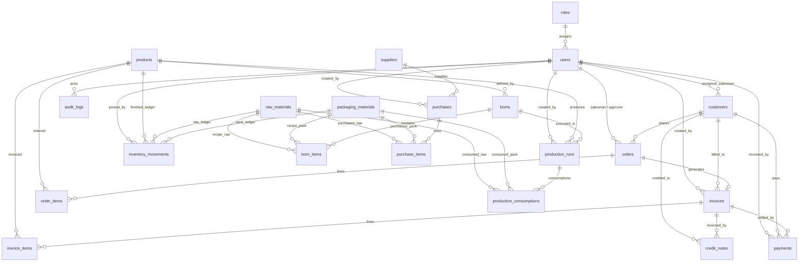

# FactoryFlow ERP — System Design & Architecture (`DESIGN.md`)

This document describes the relational database schema, end-to-end operational workflows, permanent stock ledger invariants, and weighted-average costing methodology implemented in **FactoryFlow ERP — Order-to-Audit Management System**.

---

## 1. System Architecture

```text
┌─────────────────────────────────────────────────────────────────────────┐
│ React 19 + TypeScript + Tailwind CSS SPA (Vite)                         │
│  • Role-Gated Navigation (Layout.tsx + App.tsx)                         │
│  • Mobile-first Salesman Order Portal + Offline Draft Queue             │
│  • Executive Dashboard (Recharts), GST PDF (jsPDF), Excel/CSV (SheetJS) │
└───────────────────────────────┬─────────────────────────────────────────┘
                                │ HTTPS / REST (/api/*) + HttpOnly Session Cookie (or Bearer JWT)
┌───────────────────────────────▼─────────────────────────────────────────┐
│ Express 4 API Server (server.ts)                                        │
│  • Startup JWT_SECRET entropy validation (fail-fast)                    │
│  • Auth & RBAC Middleware (auth.ts + authPolicy.ts)                     │
│  • Server-Managed HttpOnly Cookie Sessions (/auth/login, /session,      │
│    /logout, /me) with live PostgreSQL isActive & roleCode verification  │
│  • Domain Route Modules:                                                │
│     - authAndAdminRoutes.ts (Auth, Pending User Approval, Users, Audit) │
│     - mastersRoutes.ts      (Customers, Suppliers, Products, Inventory) │
│     - productionRoutes.ts   (BOMs, Purchases, Production Runs)          │
│     - salesAndFinanceRoutes.ts (Orders, GST Invoices, Payments, Reports)│
│  • Pure Accounting/ERP Engine (src/utils/erpMath.ts — integer paise)    │
│  • Operational Health Probes (/api/health, /api/health/db)              │
└───────────────────────────────┬─────────────────────────────────────────┘
                                │ Drizzle ORM + pg.Pool (Cloud SQL Unix Socket / TCP)
┌───────────────────────────────▼─────────────────────────────────────────┐
│ Google Cloud SQL for PostgreSQL                                         │
│  • 22 Normalized Relational Tables + Foreign Key Constraints            │
│  • ACID Transactions for Purchases, Production, Dispatch & Payments     │
│  • Append-only inventory_movements & audit_logs tables                  │
└─────────────────────────────────────────────────────────────────────────┘
```

---

## 2. Entity-Relationship (ER) Diagram



### Complete 22-Table Database Schema Reference (`src/db/schema.ts`)

| # | Table | Domain | Primary & Key Foreign Keys | Integrity & Mutability Rule |
| :- | --- | --- | --- | --- |
| 1 | `roles` | Identity | `id` PK, `code` UNIQUE | Defines 5 operational roles + `PENDING` |
| 2 | `users` | Identity | `id` PK, `uid`/`email` UNIQUE, `role_id → roles` | Soft deactivate (`is_active`); live-checked per request |
| 3 | `company_settings` | Config | `id` PK | Home state, GSTIN, FY, variance tolerance, costing method |
| 4 | `audit_logs` | Compliance | `id` PK, `user_id → users` | **Append-only** immutable change trail (`previous_value`/`new_value`) |
| 5 | `customers` | Masters | `id` PK, `assigned_salesman_id → users` | Soft deactivate (`is_active`); preserves invoice/payment history |
| 6 | `suppliers` | Masters | `id` PK | Edit via `PUT`; safe deactivate via `PATCH /status`; `DELETE` blocked (`409`) if linked purchases exist |
| 7 | `products` | Masters | `id` PK, `sku` UNIQUE | Soft deactivate (`is_active`); `current_stock` updated only via ledger |
| 8 | `raw_materials` | Inventory | `id` PK, `code` UNIQUE | Tracks `current_stock`, `weighted_avg_rate_paise`, `total_valuation_paise` |
| 9 | `packaging_materials` | Inventory | `id` PK, `code` UNIQUE | Tracks independent pouch/carton balances and exact valuation |
| 10 | `boms` | Production | `id` PK, `code` UNIQUE, `product_id → products` | Batch recipe, expected output, standard labour/gas/overhead paise |
| 11 | `bom_items` | Production | `id` PK, `bom_id → boms` (cascade), `raw_material_id`/`packaging_material_id` | Standard input quantities & ±3% variance threshold |
| 12 | `purchases` | Procurement | `id` PK, `purchase_no` UNIQUE, `supplier_id → suppliers`, `created_by_id → users` | Rejects inactive suppliers; posts inside ACID transaction |
| 13 | `purchase_items` | Procurement | `id` PK, `purchase_id → purchases` (cascade), raw/packaging FKs | Line quantities, rates (paise), GST %, line totals |
| 14 | `production_runs` | Production | `id` PK, `run_no` UNIQUE, `product_id`, `bom_id`, `created_by_id` | Stores good output, damaged pouches, wastage, variance flags, and cost breakdown |
| 15 | `production_consumptions` | Production | `id` PK, `production_run_id → production_runs` (cascade) | Planned vs actual + damaged qty & variance % per input material |
| 16 | `orders` | Sales | `id` PK, `order_no` UNIQUE, `customer_id`, `salesman_id`, `approved_by_id` | Lifecycle: `DRAFT → SUBMITTED → APPROVED / REJECTED → DISPATCHED` |
| 17 | `order_items` | Sales | `id` PK, `order_id → orders` (cascade), `product_id → products` | Ordered qty, verified price (paise), stock shortage tracking |
| 18 | `invoices` | GST Billing | `id` PK, `invoice_no` UNIQUE, `order_id → orders`, `customer_id`, `created_by_id` | **Never hard-deleted**; FY sequential numbering; reversed only via Credit Notes |
| 19 | `invoice_items` | GST Billing | `id` PK, `invoice_id → invoices` (cascade), `product_id` | Taxable amount, CGST/SGST or IGST split, `dispatched_qty` |
| 20 | `credit_notes` | GST Billing | `id` PK, `credit_note_no` UNIQUE, `invoice_id → invoices`, `customer_id` | Non-destructive invoice reversal + finished stock restoration |
| 21 | `payments` | Receivables | `id` PK, `payment_no` UNIQUE, `invoice_id → invoices`, `customer_id`, `recorded_by_id` | Overpayment-guarded collections (`UPI`, `NEFT`, `RTGS`, `CHEQUE`, `CASH`) |
| 22 | `inventory_movements` | Ledger | `id` PK, `txn_id` UNIQUE, `raw_material_id`/`packaging_material_id`/`product_id`, `user_id` | **Append-only** permanent stock ledger with `previous_balance` & `new_balance` |

---

## 2.5 Authentication Session & Master Governance

- **HttpOnly Cookie Sessions**: Both credential login (`POST /api/auth/login`) and Google Firebase token exchange (`POST /api/auth/session`) issue an `HttpOnly` JWT cookie (`factoryflow_session`) with `Secure; SameSite=None` on HTTPS / Cloud Run and `SameSite=Lax` on local HTTP. Browser reloads restore the session silently through `GET /api/auth/me` (`credentials: 'include'`), and `POST /api/auth/logout` expires the cookie (`Max-Age=0`). No auth tokens are persisted in `localStorage`.
- **Live Revocation**: Every protected API request validates the user's current `is_active` and `role_code` directly in PostgreSQL (`requireAuth`), so deactivated users lose access immediately.
- **Supplier Lifecycle Governance**: Suppliers can be updated via `PUT /api/suppliers/:id` (`OWNER`, `ADMIN`, `PRODUCTION_SUPERVISOR`) and safely deactivated/reactivated via `PATCH /api/suppliers/:id/status` (`OWNER`, `ADMIN`). Hard deletion via `DELETE /api/suppliers/:id` is blocked with `409 Conflict` (`SUPPLIER_HAS_HISTORY`) whenever purchase records exist, preserving referential integrity and statutory audit history. Inactive suppliers cannot be selected for new purchase receipts.

---

## 3. Sales Order-to-Cash Workflow

```text
[Salesman]                                 [Admin / Owner]
    │                                             │
    ├─► 1. Create Order (DRAFT / SUBMITTED)       │
    │      • Assigned customers only              │
    │      • Auto price list + live stock check   │
    │      • Shortage = max(0, ordered - avail)   │
    │                                             │
    │                                    2. Verify & Edit Qty/Price ◄─┤
    │                                    3. Approve / Reject Order    │
    │                                             │
    │                                    4. Generate GST Invoice      │
    │                                       • Sequential FY numbering │
    │                                         (e.g., FF/2026-27/0001) │
    │                                       • Same state → CGST+SGST  │
    │                                       • Diff state → IGST       │
    │                                       • Duplicate invoice guard │
    │                                             │
    │                                    5. Record Dispatch (ACID Tx) │
    │                                       • Checks finished stock   │
    │                                       • Deducts finished stock  │
    │                                       • Appends SALES_DISPATCH  │
    │                                         to inventory_movements  │
    │                                             │
    │                                    6. Record Payment            │
    │                                       • Prevents overpayment    │
    │                                       • Updates PAID / PARTIAL  │
    │                                       • Updates Ageing Buckets  │
    │                                             │
    │                                    (Optional) Issue Credit Note │
    │                                       • Never deletes invoice   │
    │                                       • Marks invoice REVERSED  │
    │                                       • Restores dispatched qty │
```

### Benchmark Sales Trace
1. **Retailer A (Tamil Nadu — Intra-State)**:
   - Order `ORD-2026-0001`: `150 packets` Murukku 200 g @ `₹50.00` = `₹7,500.00` taxable.
   - 5% GST split equally: `CGST 2.5% = ₹187.50` + `SGST 2.5% = ₹187.50` → **Grand Total `₹7,875.00`**.
   - Dispatched `150 packets` → Finished stock drops from `238` to **`88 packets`** (`TXN-DISP-0001-MRK`).
   - Partial payment `PAY-2026-0001` of `₹4,000.00` → Status `PARTIALLY_PAID`, **Outstanding `₹3,875.00`**.
2. **Distributor B (Karnataka — Inter-State)**:
   - Order `ORD-2026-0002`: `120 packets` Murukku 200 g @ `₹50.00`, 5% IGST (`₹300.00`), Total `₹6,300.00`, Status `SUBMITTED`.
   - Compared against `88 packets` available → **`Shortage: 32 packets`** highlighted for production planning.

---

## 4. Production & Variance Workflow

```text
[Production Supervisor / Admin / Owner]
    │
    ├─► 1. Select BOM & Batch Multiplier (e.g., BOM-MRK-200 × 1 batch)
    │      • Auto-loads standard quantities & expected output (200 packets)
    │
    ├─► 2. Enter Actual Good Output (188 pkts) & Wastage (12 pkts)
    │      • Yield Variance = (188 − 200) / 200 × 100 = -6.00% → FLAGGED (> ±3%)
    │      • Primary pouch actual usage syncs to good packets packed (188 pcs)
    │
    ├─► 3. Enter Actual Material Consumption & Packaging Damage
    │      • Flour:   40 kg    (planned 40 kg  →  0.00%)
    │      • Oil:     10.5 L   (planned 10 L   → +5.00% → FLAGGED)
    │      • Spice:   1.2 kg   (planned 1.2 kg →  0.00%)
    │      • Pouches: 188 good + 6 damaged = 194 total (planned 200 → -3.00%)
    │      • Cartons: 9 pcs    (planned 10 pcs → -10.00% → FLAGGED)
    │
    └─► 4. Atomic PostgreSQL Transaction (POST /api/production-runs)
           • Validates sufficient stock for every raw & packaging item
           • Deducts raw materials at current weighted-average valuation
           • Deducts packaging good usage (PRODUCTION_ISSUE) & damage (PRODUCTION_DAMAGE)
           • Credits finished goods (+188 pkts, PRODUCTION_RECEIPT) & updates FG avg cost
           • Saves production_runs, production_consumptions, inventory_movements & audit_logs
```

---

## 5. Permanent Inventory Ledger Architecture

Stock quantities are **never silently overwritten** in product or material edit forms. Every physical change executes inside a database transaction that updates the current balance and appends an immutable row to `inventory_movements`:

$$\text{Closing Stock} = \text{Opening} + \text{Purchases} + \text{Production Receipts} - \text{Production Issues} - \text{Production Damage} - \text{Sales Dispatches} \pm \text{Adjustments / Reversals}$$

### Mandatory Pouch Ledger Example (`PR-2026-0001`)
| Transaction ID | Movement Type | Qty In | Qty Out | Running Balance | Notes |
| --- | --- | ---: | ---: | ---: | --- |
| `TXN-OPEN-PCH` | `OPENING` | 500 | 0 | **500** | Opening stock 200 g Pouches @ ₹2.50 |
| `TXN-PR-0001-PCH-ISS` | `PRODUCTION_ISSUE` | 0 | 188 | **312** | Consumed 188 pcs for 188 good packets packed |
| `TXN-PR-0001-PCH-DMG` | `PRODUCTION_DAMAGE` | 0 | 6 | **306** | Damaged 6 pouches during sealing (`500 − 188 − 6 = 306`) |

---

## 6. Weighted-Average Costing Methodology

All monetary values are stored and calculated in **integer paise** (`1 INR = 100 paise`) inside `src/utils/erpMath.ts`.

### Receipt Valuation (`applyWeightedAverageReceipt`)
When a purchase or receipt of $Q_{\text{in}}$ units arrives at rate $R_{\text{in}}$:
$$V_{\text{new}} = V_{\text{prev}} + \text{round}(Q_{\text{in}} \times R_{\text{in}}), \quad Q_{\text{new}} = Q_{\text{prev}} + Q_{\text{in}}$$
$$R_{\text{avg, display}} = \text{round}\!\left(\frac{V_{\text{new}}}{Q_{\text{new}}}\right)$$

**Benchmark Flour Example:**
- Opening: `100 kg` @ `₹42.00` = `420,000 paise` (`₹4,200.00`)
- Purchase `PO-2026-0001`: `60 kg` @ `₹45.00` = `270,000 paise` (`₹2,700.00`)
- New Stock = `160 kg`, Total Valuation = `690,000 paise` (`₹6,900.00`)
- Exact Weighted Average = `690,000 / 160 = 4,312.5 paise/kg` (**`₹43.125/kg`**)

### Issue Valuation (`applyWeightedAverageIssue`)
To eliminate premature rounding error, issues compute proportional cost directly from exact total valuation $V_{\text{prev}}$ and stock $Q_{\text{prev}}$:
$$\text{Issue Cost} = \text{round}\!\left(\frac{V_{\text{prev}} \times Q_{\text{out}}}{Q_{\text{prev}}}\right), \quad V_{\text{new}} = V_{\text{prev}} - \text{Issue Cost}$$

**Benchmark Flour Issue (`40 kg`):**
$$\text{Issue Cost} = \text{round}\!\left(\frac{690,000 \times 40}{160}\right) = 172,500\text{ paise} = \mathbf{₹1,725.00}$$
- Remaining: `120 kg`, Remaining Valuation = `517,500 paise` (`₹5,175.00 = 120 × ₹43.125`, zero rounding loss).

### Production Batch Cost per Good Packet (`calculateProductionCostSummary`)
| Cost Component | Calculation | Amount (INR) |
| --- | --- | ---: |
| Raw Material — Flour | `40 kg × ₹43.125` | `₹1,725.00` |
| Raw Material — Cooking Oil | `10.5 L × ₹140.00` | `₹1,470.00` |
| Raw Material — Spice Mix | `1.2 kg × ₹200.00` | `₹240.00` |
| **Subtotal Raw Materials** | | **`₹3,435.00`** |
| Packaging — 200 g Pouches | `(188 good + 6 damaged) × ₹2.50` | `₹485.00` |
| Packaging — Cartons | `9 pcs × ₹15.00` | `₹135.00` |
| **Subtotal Packaging** | | **`₹620.00`** |
| Direct Labour | Batch allocation | `₹600.00` |
| Gas & Power | Batch allocation | `₹350.00` |
| Other Overheads | Batch allocation | `₹150.00` |
| **Total Batch Production Cost** | | **`₹5,155.00`** |
| **Cost per Good Packet (`188 pkts`)** | `₹5,155.00 ÷ 188` | **`₹27.42`** |
| **Gross Margin (`₹50.00` selling price)** | `₹50.00 − ₹27.42` | **`₹22.58` (`45.16%`)** |
